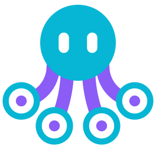

<p align="center"></p>

# Otti Connect

**Bring your own agents to Octomerge.** Otti Connect is an open-source
connector, built by Octomerge and the community. It runs the coding agents you
already use, Claude Code, Codex and Google Antigravity's CLI, on your own
computer, signed in as you, and brings them into your
[Octomerge](https://octomerge.dev) chats, next to every other model, while
their commands and file edits run on the chat's worker.

Octomerge talks to connectors through an open protocol, the
[Octomerge connector protocol](PROTOCOL.md). Otti Connect is one connector;
anyone can build another, for these agents or any other
([Build your own connector](#build-your-own-connector)).

Claude Code, Codex and Antigravity are made by Anthropic, OpenAI and Google,
which aren't affiliated with Otti Connect or Octomerge and don't endorse them.
Each agent's own terms apply when you use it through Otti Connect, and
[TERMS.md](TERMS.md) records what they allow. You choose which agents you use,
and you're responsible for following their terms.

## Run it

You need [Node.js](https://nodejs.org) 18 or later, with npm, on macOS or
Linux. On Windows, run it in WSL (the Windows Subsystem for Linux), where it
works as on Linux.

```sh
npx --registry https://npm.octomerge.dev @octomerge/otti-connect@latest
```

That is the whole setup:

1. **The first time, it installs the agents** it runs, at the versions
   Octomerge tests with it ([The agents](#the-agents)): about 470 MB to
   download, 1.2 GB on disk. Later starts use them.
2. **It signs the computer in to Octomerge**: it shows a code and an address,
   and you approve the code in your browser, where you're signed in to
   Octomerge. The computer is then one of your **agent hosts**, under
   Settings → Your agents. The sign-in is saved in
   `~/.otti-connect/connect.json`, readable only by you, and Otti Connect never
   prints it.
3. **It runs.** It asks each agent's own status command whether it is signed
   in, tells Octomerge, and waits for turns: your chats run their agent here
   while it runs. It prints a line when a turn starts and ends, never what the
   turn was asked. Stop it with Ctrl+C. While the computer sleeps, its chats
   wait.

Then [sign in to each agent](#sign-in-to-the-agents) you want to use, once.
Otti Connect notices within a few minutes and tells Octomerge.

## How it works

```text
  Octomerge ◀── agent host API (HTTPS) ── otti-connect ──▶ Claude Code  (Claude Agent SDK)
  (your chat)   the connector protocol,    on your computer ─▶ Codex        (codex app-server)
      │         one process per turn                         ─▶ Antigravity  (agy acp)
      │  Octomerge's tool calls: shell, read, write, edit, grep, find, ls …
      ▼
  the chat's worker, where the files are and the commands run
```

- Otti Connect connects your computer to Octomerge over HTTPS, through the
  [agent host API](PROTOCOL.md#the-agent-host-api), and runs one
  `otti-connect turn` process per turn, which speaks the
  [connector protocol](PROTOCOL.md) with Octomerge as JSON lines. Otti
  Connect speaks each agent's own protocol: the Claude Agent SDK for Claude
  Code, `codex app-server` (JSON-RPC) for Codex, and the Agent Client
  Protocol (`agy acp`) for Antigravity's CLI. Nothing an agent speaks reaches
  Octomerge, and Octomerge's server knows nothing about how an agent is
  driven.
- The chat's files are never on your computer. The agent works in an empty
  folder of its own, with its own file and shell tools off, and does that work
  with Octomerge's tools: an in-process MCP server for Claude Code, dynamic
  tools for Codex, and an MCP server on the loopback interface for
  Antigravity. Each call goes back to Octomerge, which runs it on the chat's
  worker and returns the result.
- Messages you send while the agent works reach it mid-turn, images
  included; Stop ends the turn, and the agent's session carries on into the
  next one.

## The agents

Otti Connect runs its own copy of each agent, at the version Octomerge has
tested with that version of Otti Connect, unmodified, as its maker publishes
it:

| Agent | Version | From | Driven through | Octomerge's tools as | Download, on disk |
| --- | --- | --- | --- | --- | --- |
| Claude Code | 2.1.331 | the Claude Agent SDK 0.3.331, which brings it, from npm | the Agent SDK's `query()`, streaming input | an in-process MCP server, `octomerge` | 190 MB, 450 MB |
| Codex | 0.172.0 | `@openai/codex` from npm | `codex app-server` (JSON-RPC 2.0) | dynamic tools | 180 MB, 450 MB |
| Antigravity's CLI | 1.5.16 | Google's release archive, checked against its SHA-512 | `agy acp` (Agent Client Protocol) | an MCP server on the loopback interface | 100 MB, 280 MB |

- **Where they live.** In `~/.otti-connect/agents/`, a folder per agent and
  version: `claude-code/2.1.331/`, `codex/0.172.0/`, `antigravity/1.5.16/`.
  Otti Connect installs them with npm (from npm's public registry,
  registry.npmjs.org) and from Google's release bucket, into a temporary
  folder that it renames into place once the install is complete and
  checked, so a half install is never used.
- **Updates.** A new version of Otti Connect brings the agent versions tested
  with it: at its first start it installs those it doesn't have, and removes
  the versions no longer used. The agents don't update themselves there:
  Otti Connect turns their own updates off for its copies, and puts back a
  copy that changed anyway at its next start.
- **Your own installs stay as they are.** Otti Connect never runs, changes or
  updates the `claude`, `codex` or `agy` you installed yourself. Both use the
  same sign-ins, which live in your home folder, not in the program.
- `otti-connect install` installs them without connecting, and
  `otti-connect status` shows them with their sign-ins.

## Sign in to the agents

Sign in to each agent you want to use, once, with the agent's own command and
its maker's own sign-in flow, in a terminal on the computer:

```sh
claude auth login
codex login                 # on a computer without a browser: codex login --device-auth
agy acp --login
```

These are the agents' own programs: yours, if you installed them, or
Otti Connect's copies, which use the same sign-ins. If you haven't installed
an agent yourself, run Otti Connect's copy by its path; `otti-connect status`
prints the exact command, such as:

```sh
~/.otti-connect/agents/codex/0.172.0/node_modules/.bin/codex login
~/.otti-connect/agents/antigravity/1.5.16/agy acp --login
~/.otti-connect/agents/claude-code/2.1.331/node_modules/@anthropic-ai/claude-agent-sdk-darwin-arm64/claude auth login
```

(Claude Code's program sits in the Agent SDK's package for your platform:
`darwin-arm64`, `darwin-x64`, `linux-x64`, `linux-arm64`.)

Otti Connect has no sign-in command of its own for any agent, and nothing
relays a sign-in code: you run each agent's own sign-in yourself.

## Your sign-ins

- Each agent uses the sign-in it has on the computer: in `~/.claude`,
  `~/.codex`, `~/.gemini` or the system keychain. Otti Connect never reads,
  copies or sends a sign-in, and Octomerge never stores a token.
- It removes the variables that would replace a sign-in (API keys, other
  endpoints) from each agent's environment, so a chat never runs on an API
  key by accident.
- One person's agents serve that person's chats only: Otti Connect has no way
  to share or pool accounts.

## Terms

Each agent's maker decides how it may be used through another product, and
those rules change. [TERMS.md](TERMS.md) records what they say today, with
sources, what Otti Connect does to stay within them, and what is still
unclear. In short:

- **Claude Code:** sign in with `claude auth login`, through Anthropic's own
  flow. Anthropic asks products built on the Agent SDK to use API keys;
  whether a Claude plan sign-in is allowed here is unclear.
- **Codex:** sign in with `codex login`. Nothing known restricts driving your
  own Codex this way.
- **Antigravity:** sign in with `agy acp --login`. A Google employee has said
  the unmodified program is fine in clients such as T3 Code; Google's forum
  says other agents handing it tasks on a personal sign-in is not. Use it in
  chats you drive yourself.

Corrections are welcome: open an issue or a pull request with the source.

## Commands

| Command | |
| --- | --- |
| `otti-connect`, `otti-connect start` | Installs the agents it lacks, signs the computer in if it isn't, connects it and runs its turns |
| `otti-connect status` | The agents, their versions and sign-ins, and this computer's sign-in to Octomerge, without connecting |
| `otti-connect install` | Installs the agents without connecting |
| `otti-connect logout` | Forgets this computer's sign-in and revokes it in Octomerge |
| `otti-connect --version` | Otti Connect's version and the protocol version it speaks |

With `npx`, put the command after the package:
`npx --registry https://npm.octomerge.dev @octomerge/otti-connect@latest status`.
(`@latest` makes npx check for a newer release instead of running the copy it
cached.)

| Option | |
| --- | --- |
| `--base-url <url>` | The Octomerge to connect to. Default: `$OTTI_CONNECT_BASE_URL`, else the one the computer signed in to, else https://octomerge.dev |
| `--label <name>` | The computer's name in Octomerge when it first connects: letters, digits, dots, hyphens and underscores. Default: `$OTTI_CONNECT_LABEL`, else its host name. Once it is connected, rename it in Octomerge's Settings → Your agents |
| `--config-dir <dir>` | Where the sign-in is kept. Default: `~/.otti-connect` |
| `--agents-dir <dir>` | Where the agents are installed. Default: `$OTTI_CONNECT_AGENTS_DIR`, else `agents` in the config folder |
| `--no-open` | Doesn't open the approval page in the browser |

`install` also takes `--platform <os/arch>` (such as `linux/arm64`), which
installs the agents for another platform without running them, and
`--bin-dir <dir>`, which puts links to the agents' own programs (`claude`,
`codex`, `agy`) into a folder; the [container image](container/README.md) is
built with both.

One Otti Connect runs per sign-in: a second one with the same `--config-dir`
refuses to start. To connect the computer to another Octomerge, run
`otti-connect logout` first, or give that one a `--config-dir` of its own.

## In Docker, on an always-on computer

The [container image](container/README.md) runs Otti Connect with the same
agents at the same versions. You approve its sign-in once and sign in to each
agent inside it, once; the sign-ins stay in its volume.

## Troubleshooting

- **An agent shows as not installed.** `otti-connect status` says why: no
  network, no npm, a download that didn't match its checksum, no build for
  this platform. Otti Connect goes on with the other agents and tries again
  at its next start; `otti-connect install` tries at once.
- **npm isn't found.** Otti Connect installs Claude Code and Codex with npm:
  install Node.js with npm (the installers from nodejs.org and most package
  managers include it).
- **Behind a proxy.** npm's own settings (`~/.npmrc`: `proxy`,
  `https-proxy`, `cafile`) apply to the agents' installs from npm. Otti
  Connect's own requests, to Octomerge and for Antigravity's archive, use
  `HTTPS_PROXY` when `NODE_USE_ENV_PROXY=1` is set (Node.js 22.21, or 24
  and later).
- **Disk space.** The three agents take about 1.2 GB. During an update, the
  new version is installed before the old one is removed.
- **"Another Otti Connect … is installing agents".** Two Otti Connects share
  the agents folder and only one installs at a time; the other waits.
- **"Otti Connect already runs with the sign-in".** Another Otti Connect with
  the same config folder runs on this computer: stop it first, or give this
  one a `--config-dir` of its own.
- **"Another computer of yours is connected … as <label>".** Start Otti
  Connect with `--label <name>` to give this computer a name of its own.
- **Antigravity's sign-in shows as unknown.** `agy` has no command that says
  whether it is signed in. If a turn says it isn't, run `agy acp --login`.
- **Starting over.** `otti-connect logout` signs the computer out of
  Octomerge; removing `~/.otti-connect` removes the sign-in and the agents,
  and the next start installs them again. The agents' own sign-ins (in
  `~/.claude`, `~/.codex`, `~/.gemini`) stay.
- **Windows.** Otti Connect doesn't run on Windows yet: run it in WSL.

## Build your own connector

A connector is any program that runs where an agent is installed and signed
in, and speaks the [Octomerge connector protocol](PROTOCOL.md) for each turn:
one process per turn, JSON lines in both directions.
[`src/protocol.ts`](src/protocol.ts) has the protocol's types in one file
without imports, and `src/agents/` shows how Otti Connect adapts three agents
to it. To connect a computer to Octomerge by itself, a connector also speaks
the [agent host API](PROTOCOL.md#the-agent-host-api):
[`src/host-api.ts`](src/host-api.ts) has its types, and `src/host.ts` is Otti
Connect's side of it.

## The protocol

[PROTOCOL.md](PROTOCOL.md) describes version 1 of the Octomerge connector
protocol, and [`src/protocol.ts`](src/protocol.ts), a file without imports,
has its types.
In short: the client writes `start`, then `tool_result` and `message` lines;
the connector writes `hello`, `session`, `text`, `thinking`, `tool_started`,
`tool_completed`, `tool_call`, `usage`, `waiting`, `working`, `received`,
`turn_end` and `error`, each numbered with `seq`. Its
[agent host API](PROTOCOL.md#the-agent-host-api) section describes how a
connector connects a computer to Octomerge and carries those lines over
HTTPS: a device sign-in, `register`, a long `poll` for the commands that
start, feed and stop turns, and `output` at byte offsets.

## Layout

| Path | |
| --- | --- |
| `PROTOCOL.md`, `src/protocol.ts` | The Octomerge connector protocol, version 1 |
| `src/host-api.ts` | The agent host API's types, version 1 |
| `src/versions.ts` | The agents' pinned versions, and Antigravity's archives with their SHA-512 (a file without imports) |
| `TERMS.md` | What each agent's terms allow, with sources |
| `src/main.ts` | The commands: `start`, `status`, `install`, `logout`, `turn`, `--version` |
| `src/install.ts` | The installer: the pinned agents into the agents folder |
| `src/host.ts` | The agent host: registers, polls, runs each turn as an `otti-connect turn` process and uploads its output |
| `src/signin.ts`, `src/config.ts`, `src/lock.ts` | The device sign-in and logout; `connect.json`; one process per sign-in, one installer at a time |
| `src/http.ts` | JSON over HTTPS to Octomerge |
| `src/turn.ts` | One turn: reads the client's lines, starts the agent, writes the events |
| `src/agents/pinned.ts` | Where the installed agents and their programs are |
| `src/agents/report.ts` | What Otti Connect reports about each agent: installed, version, signed in |
| `src/agents/claude.ts` | Claude Code through the Agent SDK's `query()`; the client's tools as an in-process MCP server |
| `src/agents/codex.ts` | Codex's app-server; the client's tools as dynamic tools |
| `src/agents/antigravity.ts`, `gemini-schema.ts` | Antigravity's ACP server; the client's tools as an MCP server on the loopback interface, their schemas as its CLI takes them |
| `container/` | The container image: Otti Connect and the agents |

## Environment

| Variable | |
| --- | --- |
| `OTTI_CONNECT_BASE_URL` | The Octomerge to connect to, when `--base-url` doesn't name one |
| `OTTI_CONNECT_LABEL` | The computer's label, when `--label` doesn't name one |
| `OTTI_CONNECT_AGENTS_DIR` | Where the agents are installed, when `--agents-dir` doesn't name it |

For developing and testing Otti Connect, these name other copies of the
agents; Otti Connect then doesn't install or run its own copy of that agent:

| Variable | |
| --- | --- |
| `OTTI_CONNECT_HOME` | A folder whose `node_modules` hold the Claude Agent SDK, `@modelcontextprotocol/sdk` and `zod` |
| `OTTI_CONNECT_CLAUDE` | A `claude` for the Agent SDK to drive instead of the build it brings |
| `OTTI_CONNECT_CODEX`, `OTTI_CONNECT_AGY` | A `codex` or `agy` to run |

## Development

You need Node.js 18 or later and [Bun](https://bun.sh) to build.

```sh
bun install
bun run build          # dist/otti-connect.mjs: one Node.js file, no dependencies
node dist/otti-connect.mjs status
node dist/otti-connect.mjs --base-url https://octomerge.example.com   # another Octomerge
echo '{"type":"start","protocol":1,"turn":{"id":"t","messageId":"m"},"agent":{"kind":"codex"},"workspace":{"folder":"f"},"instructions":"","tools":[],"message":{"text":"hi"}}' \
  | node dist/otti-connect.mjs turn
```

A build from source calls itself version `0.0.0-development`; a release
stamps its version in.

## License

Apache License 2.0: [LICENSE](LICENSE) and [NOTICE](NOTICE). Claude Code,
the Claude Agent SDK, Codex and Antigravity's CLI belong to their owners and
come under their own licenses and terms; Otti Connect doesn't include them,
and installs each from its maker's own release. Their names appear here only
to say which agents Otti Connect runs.
